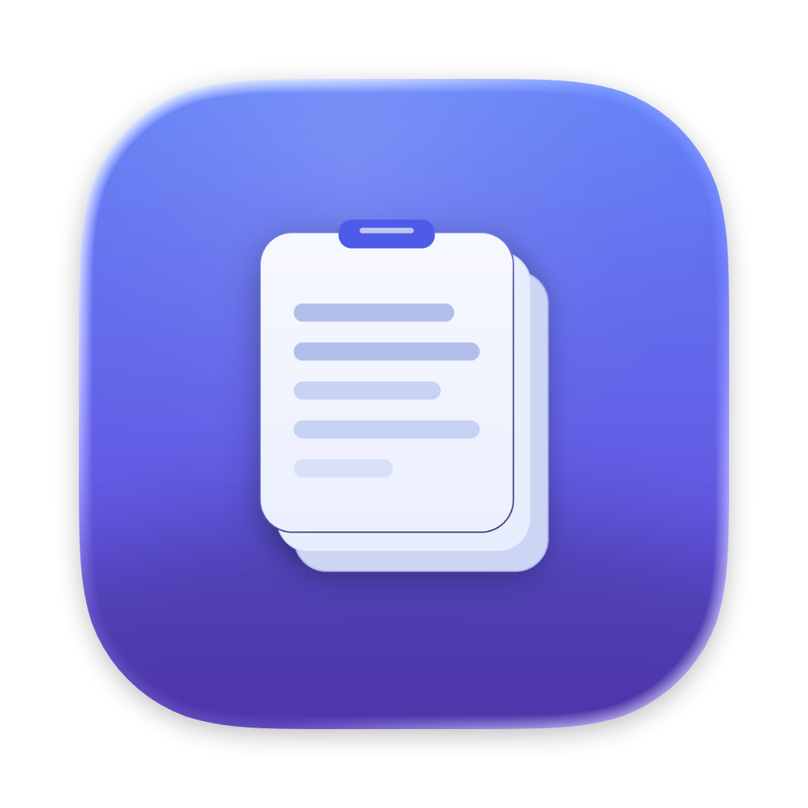
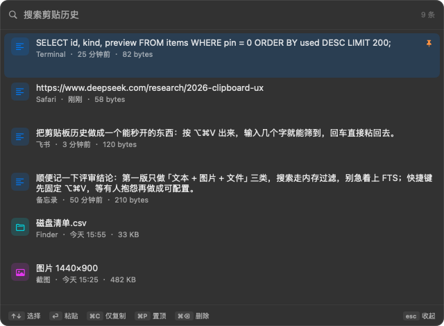
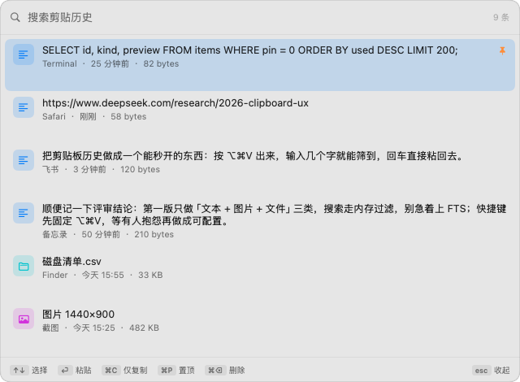
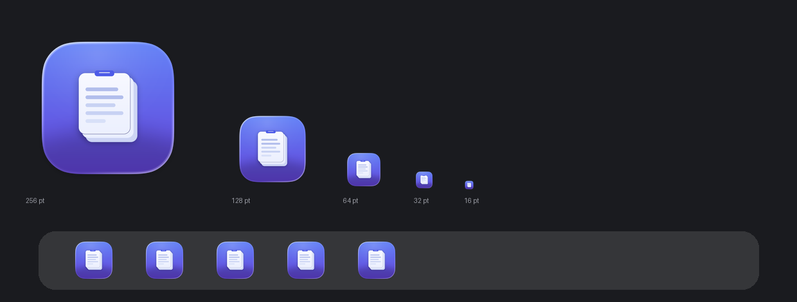

# ClipShelf

**剪贴板的「最近使用」。按 `⌥⌘V` 召出，打几个字筛一下，回车就把它粘回你刚才在写的地方。**


纯本地：SQLite 存本机、不联网、不上传、自动跳过密码管理器。
原生 Swift（AppKit + SwiftUI），没有 Electron、没有后台服务、没有第三方依赖。



<p>
  
  
</p>

## 安装

```bash
git clone https://github.com/Dacong0304/clipshelf.git
cd clipshelf
./install.sh
```

也可以先只编译看看：

```bash
make build && make test     # 编译 + 跑 12 项自检
```

`install.sh` 会调用 `build.sh` 编译，装到 `~/Applications/ClipShelf.app` 并启动。
不需要 sudo，不需要 Xcode 工程，只要有 Command Line Tools 里的 `swiftc`。

打包成可分发的 zip：

```bash
make release            # → dist/ClipShelf-1.0.0.zip
```

> 产物是本地 ad-hoc 签名的，没有经过 Apple 公证。别人第一次打开时需要
> 右键 →「打开」，或执行 `xattr -dr com.apple.quarantine ClipShelf.app`。
> 真要分发给你不认识的用户，还是得走开发者证书 + notarization。

装好后：

| 想做的事 | 怎么做 |
| --- | --- |
| 打开历史 | `⌥⌘V`，或点菜单栏的剪贴板图标 |
| 让它开机就在 | 菜单栏图标 → **开机自动启动** |
| 让回车直接粘回去 | 菜单栏图标 → **自动粘贴权限…** → 在「辅助功能」里勾上 ClipShelf |
| 临时别记 | 菜单栏图标 → **暂停记录** |

> 没给辅助功能权限也能用：回车会把内容放回剪贴板并收起面板，你自己按 `⌘V` 就行。
> 给了权限，回车就等于「复制 + 粘贴」一步到位。

## 图标



一张纸是内容，一叠纸是历史：白纸叠 + 顶部夹子 + 正文条，蓝紫渐变底。
字母 / 文字一律不用，16pt 下仍能认出是「一叠纸」而不是随便一个方块。

图标由脚本生成，不是手绘位图：

```bash
python3 design/icon.py           # 重新出 docs/icon-a.png（1024 满幅源图）
python3 design/icon.py icns      # 出 AppIcon.icns（16–1024 十个尺寸）
python3 design/icon.py board     # 出方案对比板（改配色/形状时用）
```

改渐变、纸的错位量、线条宽度都在 `design/icon.py` 顶部的常量里，改完重跑 `icns` 再
`./install.sh` 就换上了。

> **为什么图是满幅的、没有留白、四角不是圆的？**
> macOS 26 起，系统只对「完全不透明」的图标自动裁圆角蒙版；带透明边角（老式的
> 824×824 留白画法）会被塞进一层灰色底板里，看起来像被缩小了一圈。所以源图是
> 1024 满幅不透明，圆角交给系统裁 —— 这也是现在原生 App 的做法。
> 代价是：这套图在 macOS 15 及更早的版本上会显示成方形，那些系统需要老式的圆角版本。

菜单栏用的仍是系统符号 `list.clipboard`（跟随深/浅色、随菜单栏缩放），没有换成
自绘线条图 —— 系统符号在小尺寸下的对齐与字重更稳。

## 交互

| 按键 | 结果 |
| --- | --- |
| `⌥⌘V` | 召出 / 收起面板（全局，任何 App 里都行） |
| 直接打字 | 即时过滤；空格分隔多个关键词，取「同时包含」 |
| `↑` `↓` | 移动选中项，列表跟随滚动 |
| `⏎` | 粘回刚才的 App（没授权时=复制并提示按 ⌘V） |
| `⌘C` | 只放回剪贴板，不粘贴、不关面板以外的动作 |
| `⌘P` | 置顶 / 取消置顶（置顶项永远排最前，不参与淘汰） |
| `⌘⌫` | 删除当前项 |
| `esc` | 收起 |
| 单击某一行 | 选中并直接粘贴 |

面板失焦会自动收起，不会挡在那里。

## 它是怎么工作的

```
        ┌──────────────── 0.35s 轮询 ────────────────┐
        │  NSPasteboard.general.changeCount 变了吗？  │
        └───────────────────┬────────────────────────┘
                            │ 变了
                 ┌──────────▼──────────┐
                 │ 隐私闸门             │  Concealed / Transient 标记 → 丢弃
                 │                     │  前台是密码管理器        → 丢弃
                 └──────────┬──────────┘
                            │ 放行
                 ┌──────────▼──────────┐
                 │ 分类                 │  文件 → 文本 → 图片（按此优先级）
                 └──────────┬──────────┘
                            │
              ┌─────────────▼─────────────┐
              │ SHA-256 摘要去重            │  已存在 → 只把 used 顶到最新
              │ 新内容 → SQLite + blobs/   │  超上限 → 淘汰最旧的未置顶项
              └───────────────────────────┘

   ⌥⌘V ──► Carbon 全局热键 ──► 面板（NSHostingView + SwiftUI）
                                  │
                                  ├─ 内存过滤（<1ms，800 条以内）
                                  └─ ⏎ ──► 写回 NSPasteboard ──► CGEvent ⌘V（需辅助功能）
```

### 几个关键决定

**为什么轮询而不是监听通知。**
macOS 没有公开的「剪贴板变了」通知。`changeCount` 是个整数，比较一次的成本可以忽略，
这也是所有剪贴板管理器的通行做法。0.35s 的间隔对人是无感的，而且不需要任何权限。

**为什么用 SHA-256 摘要去重。**
同一段内容会被复制很多次（尤其是代码和链接）。用内容摘要做主键，重复复制只更新时间戳，
列表不会被同一段文字刷屏。图片同理，本体按摘要命名落在 `blobs/<sha>.png`，库里只存路径。

**为什么图片要落盘而不是塞进数据库。**
一张 Retina 截图动辄几 MB，塞进 SQLite 会让库文件迅速膨胀、`--dump` 变慢。
落盘后可以做引用计数清理：删记录时顺手删掉没人引用的图片（`gcBlobs`）。

**为什么置顶项不参与淘汰。**
淘汰规则是「超过 600 条删最旧的」，但置顶是用户明确说「这个别丢」。
所以置顶项既不计数、也不删除，相当于一个小收藏夹。

**为什么热键用 Carbon 的 `RegisterEventHotKey`。**
它注册的是系统级热键，不需要辅助功能权限、不抢焦点、也不会被输入法吃掉。
`CGEvent` 模拟 `⌘V` 才是那个需要「辅助功能」授权的部分 —— 两件事分开了，
所以没授权的人依然可以用完整的历史和搜索，只是少了自动粘贴那一步。

**为什么不做成 Electron / Python 小工具。**
菜单栏常驻 + 全局热键 + 秒开面板，这套东西对启动延迟和内存占用很敏感。
原生 AppKit + SwiftUI 实测常驻内存约 85MB（含 SwiftUI/AppKit 框架映射），面板是即时出现的；
Electron 同类工具通常 200MB 起步，而且每次唤起都有可见的延迟。

### 数据模型

```sql
CREATE TABLE items (
    id      INTEGER PRIMARY KEY AUTOINCREMENT,
    kind    TEXT    NOT NULL,        -- text | image | files
    content TEXT    NOT NULL,        -- 正文 / 图片路径 / 换行分隔的文件路径
    preview TEXT    NOT NULL,        -- 列表里那一行摘要（折叠换行，截断 240 字）
    source  TEXT    NOT NULL,        -- 复制时前台 App 的名字
    bytes   INTEGER NOT NULL,        -- 用来在 meta 行显示大小
    pin     INTEGER NOT NULL,        -- 置顶
    created REAL    NOT NULL,
    used    REAL    NOT NULL,        -- 排序键：置顶优先，其次最近使用
    digest  TEXT    NOT NULL         -- 内容 SHA-256，唯一索引
);
CREATE UNIQUE INDEX idx_digest ON items(digest);
CREATE INDEX idx_order ON items(pin DESC, used DESC);
```

上限：600 条文本/文件，图片额外收紧到 120 张（各 8MB 封顶），文本 2MB 封顶。
超出的按 `used` 从旧到新淘汰，置顶项豁免。

### 隐私

剪贴板里有密码、验证码、私钥。所以：

1. **标记即丢弃**：内容带 `org.nspasteboard.ConcealedType` / `TransientType` /
   `AutoGeneratedType` 的，一律不记录 —— 1Password、Bitwarden 这些都会打这个标记。
2. **前台是密码管理器就跳过**：内置一份 bundle id 名单（1Password、Bitwarden、LastPass、系统钥匙串…）。
3. **可以随时暂停**，也可以一键清空（保留置顶）。
4. **不出本机**：没有任何网络代码，数据库在 `~/Library/Application Support/ClipShelf/`。

已知边界：如果某个密码管理器既不写 Concealed 标记、也不在名单里，它的内容仍可能被记录。
遇到这种情况，把它加进 `Sources/Capture.swift` 的 `secretBundleIDs`，或者干脆用「暂停记录」。

### 存储与清理

```bash
DB=~/Library/Application\ Support/ClipShelf/history.db

sqlite3 "$DB" 'select count(*) from items'              # 多少条
sqlite3 "$DB" 'delete from items where pin = 0'         # 清空（保留置顶）
du -sh ~/Library/Application\ Support/ClipShelf         # 占多大
```

卸载：菜单里退出 → 删掉 `~/Applications/ClipShelf.app`、上面那个目录，
以及（如果开过自启）`~/Library/LaunchAgents/local.clipshelf.agent.plist`。

## 命令行

App 本体同时是个 CLI，方便脚本和排障：

```bash
B=~/Applications/ClipShelf.app/Contents/MacOS/ClipShelf

$B --dump --limit 20     # 打印历史
$B --selftest            # 自检：去重、置顶、淘汰、搜索、摘要、时间文案
$B --toggle              # 让运行中的实例弹出/收起面板
$B --state               # 打印面板状态（可见性、焦点、选中项、热键是否注册成功）
$B --autostart on|off    # 开机自启开关（等同菜单里的那一项）
$B --snapshot out.png    # 用演示数据渲染面板快照（--appearance light|dark）
```

`--toggle` 和 `--state` 走的是 DistributedNotification，所以可以接快捷指令、Alfred、
Raycast、Hammerspoon —— 任何能执行 shell 的地方都能唤起它。

## 项目结构

```
clip-shelf/
├── Sources/
│   ├── Store.swift      SQLite 存储、去重、淘汰、图片引用计数
│   ├── Capture.swift    剪贴板轮询、分类、隐私闸门、摘要
│   ├── HotKey.swift     Carbon 全局热键、CGEvent 粘贴注入、Toast
│   ├── UI.swift         SwiftUI 面板、键盘处理、面板窗口、快照渲染
│   └── main.swift       入口、菜单栏、开机自启、自检
├── design/icon.py       图标生成脚本（渐变底、纸叠、icns 导出）
├── AppIcon.icns         生成的图标（1024 满幅不透明）
├── Info.plist
├── Makefile             build / install / test / icon / clean
├── build.sh             编译出 ClipShelf.app
├── install.sh           装到 ~/Applications 并启动
├── LICENSE              MIT
├── .github/workflows/   CI：编译 + 自检 + 产物
└── docs/                截图
```

## 还没做的

- 富文本样式（现在只保纯文本，粘回去会丢格式）
- 图片缩略图预览（列表里目前只显示尺寸）
- 快捷键自定义（先固定 `⌥⌘V`，等真有人抱怨再说）
- 按 App 过滤（「只看从 Chrome 复制的」）
- 密码管理器名单可视化配置

---

用 `--selftest` 跑一遍就知道核心逻辑有没有被动坏：
去重、置顶排序、淘汰豁免、多关键词搜索、摘要折叠、相对时间文案，共 12 项。

## 许可

MIT © [Dacong0304](https://github.com/Dacong0304)

剪贴板里可能有密码、私钥、验证码。这个项目从第一天就按「数据不出本机」来写，
代码里没有任何网络请求；如果你发现哪里不符合这个承诺，欢迎提 issue。
